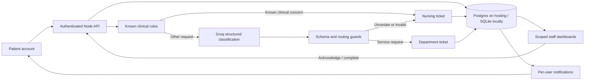

# Architecture

`server.cjs` hosts the local app and `api/index.js` adapts it to Vercel. Both use `lib/handler.cjs`; the frontend never contacts providers directly. `routing.js` contains clinical precedence, model validation, canonical department policy, and receipt templates. `lib/auth.cjs` handles hashed passwords, hashed session tokens, and permissions. `lib/store.cjs` provides SQLite/Postgres operations and transactions.

Identity and room come from the server session. Patients read only their tickets, staff read and act only on their department, and coordinators see all departments. Sessions last eight hours with HttpOnly, SameSite=Lax cookies and Secure cookies on hosting. Origin checks protect browser mutations and login throttling limits failed attempts. These controls support synthetic demos; they do not establish hospital compliance or enterprise identity readiness.

Known clinical triggers and the urgent button bypass AI. Provider calls time out after six seconds. Outages use labelled rules fallback for clear routine requests and nursing for unclear input. Invalid or low-confidence model output goes to nursing. Server-derived tier/responder and fixed receipts prevent invented assignees and arrival promises. Confidence is model self-report.

An input creates a primary ticket and at most one service task. Original clinical text stays on the nursing ticket; the support task contains only its service summary. Creation and updates store audit events. Patient-scoped retry identifiers prevent duplicate tickets, including concurrent submissions.

Status moves from NEW to ACKNOWLEDGED to RESOLVED through authorized staff actions. Durable notifications address individual users: assigned staff, the coordinator, and the originating patient. Two-second polling works across Vercel instances without an in-memory event bus. Closed-browser push and hospital paging are not implemented.

Metrics derive from visible records. Non-clinical share measures requests/tasks, not proven avoided interruptions. Nursing minutes are an editable scenario estimate. Only primary tickets contribute to classifier duration, so generated service tasks do not lower its average.
